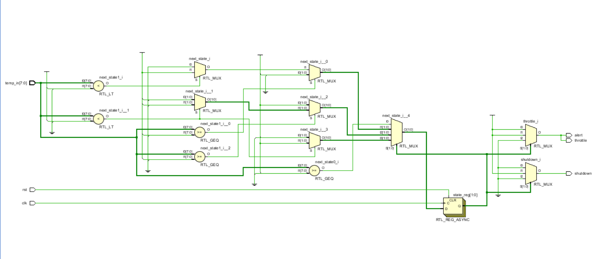
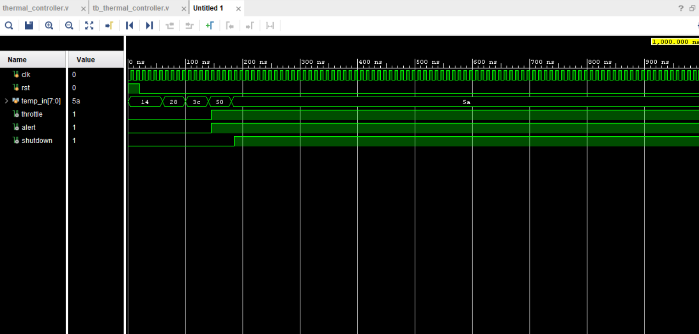
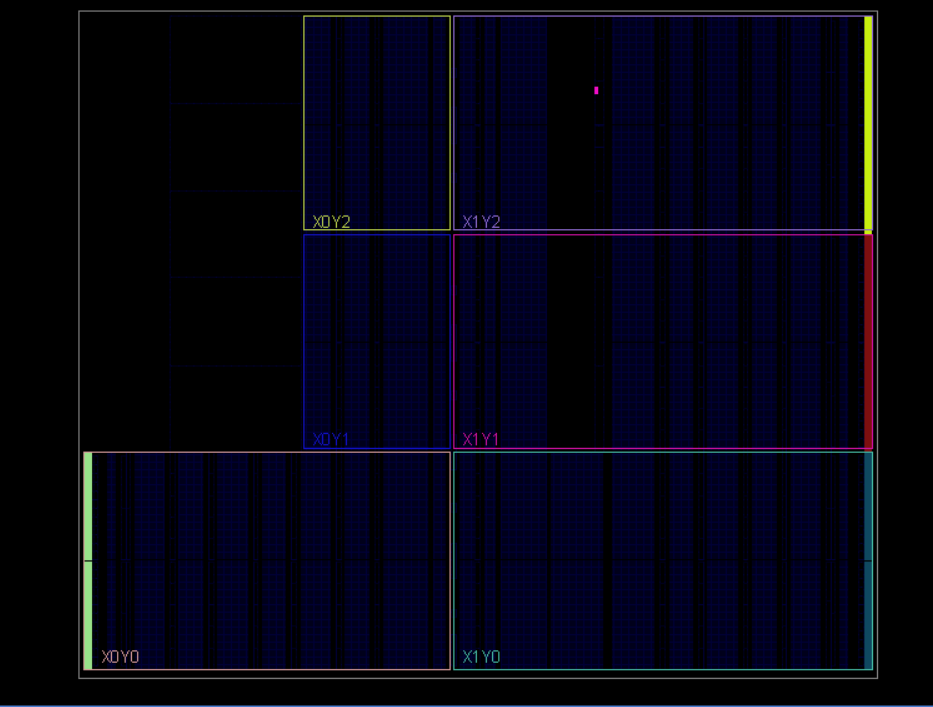

# Thermal Process Controller (Verilog FSM)

A synthesizable **4-state Moore finite state machine** in Verilog that monitors
an 8-bit temperature sensor input and manages thermal protection outputs
(`throttle`, `alert`, `shutdown`) as configurable temperature thresholds are
crossed.

## States & thresholds

| State | Entered when | `throttle` | `alert` | `shutdown` |
|---|---|:---:|:---:|:---:|
| `IDLE`     | `temp_in < NORMAL_T` (50)              | 0 | 0 | 0 |
| `NORMAL`   | `NORMAL_T <= temp_in < WARNING_T` (70) | 0 | 0 | 0 |
| `WARNING`  | `WARNING_T <= temp_in < CRITICAL_T` (85) | 1 | 1 | 0 |
| `CRITICAL` | `temp_in >= CRITICAL_T`                | 1 | 1 | 1 |

Transitions are temperature-driven in both directions — e.g. from `CRITICAL`
the FSM drops back to `NORMAL` (not straight to `IDLE`) once `temp_in` falls
below `WARNING_T`, and from `WARNING` it falls back to `NORMAL` once below
`WARNING_T`, or further to `IDLE` from `NORMAL` once below `NORMAL_T`.

Default thresholds (overridable via Verilog `parameter`):
- `NORMAL_T   = 50`
- `WARNING_T  = 70`
- `CRITICAL_T = 85`

## Repository structure

```
ThermalProcessController/
├── src/
│   └── thermal_controller.v      # FSM RTL
├── tb/
│   └── tb_thermal_controller.v   # Self-checking testbench / stimulus
├── docs/
│   └── images/
│       ├── rtl_schematic.png       # Synthesized RTL schematic (Vivado)
│       ├── simulation_waveform.png # Behavioral sim waveform
│       └── device_floorplan.png    # FPGA device/floorplan view
└── README.md
```

## RTL schematic



## Simulation waveform

Simulated with the provided testbench, sweeping `temp_in` through
`20 → 40 → 60 → 80 → 90`:



As `temp_in` crosses each threshold, `throttle`/`alert` assert at `WARNING`
and `shutdown` additionally asserts at `CRITICAL`, matching the state table
above.

## Device floorplan



## Simulating

**Icarus Verilog + GTKWave**
```bash
iverilog -o sim.out src/thermal_controller.v tb/tb_thermal_controller.v
vvp sim.out
gtkwave tb_thermal_controller.vcd
```

**Vivado / other IDEs**
Add `src/thermal_controller.v` as a design source and
`tb/tb_thermal_controller.v` as a simulation source, then run behavioral
simulation.

## License

See `LICENSE`.
